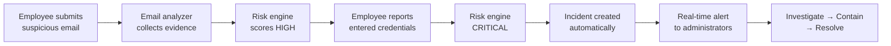
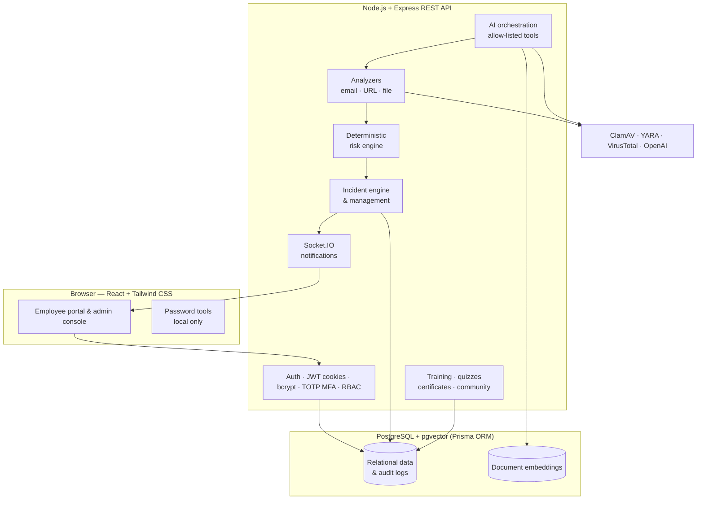

<p align="center">
  
</p>

<h1 align="center">EWAGuard AI</h1>

<p align="center">
  <strong>An AI-powered enterprise cybersecurity and Bahrain PDPL assistant for employee threat analysis,
  incident triage and security awareness.</strong>
</p>

<p align="center">
  
  
  
  
  
  
</p>

<p align="center">
  <a href="#overview">Overview</a> ·
  <a href="#features">Features</a> ·
  <a href="#architecture">Architecture</a> ·
  <a href="#getting-started">Getting started</a> ·
  <a href="#security-and-privacy">Security</a> ·
  <a href="#testing">Testing</a> ·
  <a href="#documentation">Docs</a>
</p>

---

## Overview

Employees receive phishing emails, suspicious links and unknown files every day, and often do not know whether
something is dangerous or what to do next. Security teams, meanwhile, learn about incidents late and with incomplete
information.

**EWAGuard AI** gives every employee one secure place to check something suspicious, receive clear guidance, and
have real threats escalated to the IT/security team automatically. It also helps prevent incidents through short
awareness courses, quizzes, certificates and a moderated security community.

The platform is built around one rule:

> **Security tools detect. The risk engine evaluates. AI explains and coordinates.**

The language model never decides on its own whether something is malicious. Scanners and checks such as ClamAV,
YARA, DNS/TLS and VirusTotal produce evidence; a deterministic, unit-tested risk engine turns that evidence into a
score and severity; the AI explains the result in plain language and coordinates the next step.

> [!NOTE]
> EWAGuard AI is a university graduation project and enterprise prototype. It does not replace endpoint protection,
> a SIEM, a SOC, or legal advice, and it never claims that an email, URL or file is guaranteed safe.

## Features

### For employees

| Area | What it does |
| --- | --- |
| **AI security assistant** | Chat about security concerns; the assistant can run approved analysis tools after explicit confirmation. |
| **Email analyzer** | Analyzes pasted emails or `.eml` files: sender and Reply-To mismatch, impersonation, links, attachments, urgency and credential requests. SPF/DKIM/DMARC are reported as unavailable when they cannot be checked. |
| **URL analyzer** | Checks URL structure, lookalike and punycode domains, DNS, TLS certificates and reputation, without loading the page and with SSRF protection. |
| **File analyzer** | Accepts bounded uploads and runs SHA-256 hashing, ClamAV, YARA and hash reputation lookups. Uploaded files are never executed. |
| **Password security** | Checks password strength with zxcvbn and generates passwords with Web Crypto, entirely in the browser. |
| **Incident assistance** | Gives step-by-step guidance after an analysis, and lets the employee report exposure (for example, "I entered my credentials"). |
| **My incidents** | Lets employees follow their own reports and the updates the security team shares with them. |
| **PDPL and policy assistant** | Answers Bahrain PDPL and company-policy questions using retrieval-augmented generation, with sources. |
| **Awareness training** | Seven short courses (phishing, safe browsing, data privacy, physical security, incident reporting, secure remote work, responsible AI), each with a quiz. |
| **Monthly quizzes and certificates** | Monthly knowledge checks with score history, and PDF certificates issued only after legitimate completion. |
| **Security community** | Lets employees share warnings and tips; posts are visible to others only after moderation. |

### For IT/security administrators

| Area | What it does |
| --- | --- |
| **MFA-protected access** | Administrators sign in with password plus TOTP, verified on the server. |
| **Incident queue** | Triage view of open incidents ordered by severity and waiting time, with unassigned and assigned-to-me views, search, severity filters and a severity-themed interface. |
| **Investigation workspace** | Evidence, timeline, assignment, one-click lifecycle steps (`NEW → UNDER_INVESTIGATION → CONTAINED → RESOLVED → CLOSED`), and internal or employee-visible notes. |
| **Real-time alerts** | High and critical incidents trigger Socket.IO notifications, delivered only to authorized users. |
| **User management** | Account lifecycle, roles, and shareable invite links for self-registration (expiring, use-limited, revocable). |
| **Training and quiz management** | Draft, review, approve and publish courses and monthly quizzes. AI drafts never publish automatically. |
| **Analytics** | Security, incident and awareness analytics, including completion rates, pass rates and score trends. |
| **Moderation and audit** | Community moderation and a searchable audit log of security-sensitive actions. |

### End-to-end scenario



## Architecture



### Technology stack

| Layer | Technologies |
| --- | --- |
| Frontend | React 19, React Router 7, Tailwind CSS 4, Vite, lucide-react |
| Backend | Node.js 24, Express 5, REST, Socket.IO |
| Database | PostgreSQL, pgvector, Prisma ORM 7 |
| Authentication | JWT in HTTP-only cookies, bcrypt, TOTP MFA (otpauth), rate limiting, Helmet |
| AI | OpenAI Responses API with function/tool calling, embeddings, RAG |
| Security analysis | MailParser, ClamAV, YARA, VirusTotal, Node.js crypto (SHA-256), zxcvbn |
| Documents | PDFKit (certificates), pdf.js (knowledge ingestion), sharp (community images) |

### Repository structure

```text
ewaguard-ai/
├── backend/
│   ├── prisma/            # schema, migrations and seeds
│   ├── scripts/           # provisioning, knowledge ingestion, retention and verification
│   ├── security/          # project-owned YARA starter rules
│   ├── src/
│   │   ├── ai/            # OpenAI adapter, chat policy, tool registry and approvals
│   │   ├── analyzers/     # email, URL and file analysis
│   │   ├── risk/          # deterministic risk engine
│   │   ├── incidents/     # incident engine and management
│   │   ├── rag/           # chunking, embeddings and retrieval
│   │   ├── training/      # courses, quizzes and monthly quiz content
│   │   ├── certificates/  # PDF certificates
│   │   ├── community/     # posts, comments, reports and moderation
│   │   ├── notifications/ # persistence and Socket.IO delivery
│   │   ├── users/         # accounts, setup and invite links
│   │   └── routes/        # Express routers
│   └── tests/             # unit and integration tests
├── frontend/
│   ├── src/
│   │   ├── features/      # feature modules (incidents, chat, training…)
│   │   ├── components/    # shared UI components
│   │   └── layouts/ pages/ context/ services/
│   └── tests/             # component and flow tests
├── shared/                # policy shared by frontend and backend
├── docs/                  # architecture, feature and security documentation
└── AGENTS.md              # development and security rules
```

## Getting started

### Prerequisites

- **Node.js 24.13+** and **npm 11**
- **PostgreSQL** with the **pgvector** extension installed
- Optional, for full analysis: **ClamAV**, **YARA**, an **OpenAI API key** and a **VirusTotal API key**. When a
  service is not configured, the application reports it as unavailable instead of inventing a result.

### Installation

```bash
git clone https://github.com/AkramAldahyani/ewaguard-ai.git
cd ewaguard-ai
npm ci
cp .env.example .env        # PowerShell: Copy-Item .env.example .env
```

Edit `.env` and replace every placeholder. At minimum, set:

| Variable | Purpose |
| --- | --- |
| `DATABASE_URL` | PostgreSQL connection string |
| `JWT_SECRET` | Random secret of at least 32 characters |
| `MFA_ENCRYPTION_KEY` | 32 random bytes as 64 hex characters, required for administrator MFA |
| `TOOL_APPROVAL_ENCRYPTION_KEY` | Key for encrypted AI tool approvals |
| `DEV_EMPLOYEE_PASSWORD`, `DEV_ADMIN_PASSWORD` | Local-only passwords for the two development accounts |
| `OPENAI_API_KEY` | Optional; enables the AI assistant and RAG |
| `VIRUSTOTAL_API_KEY`, `CLAMAV_PATH`, `YARA_PATH` | Optional; enable reputation and malware scanning |

See [`.env.example`](.env.example) for every option and its default.

### Database and accounts

```bash
npm run db:migrate      # apply migrations (requires pgvector)
npm run db:seed         # roles and departments
npm run db:seed:auth    # local employee and administrator accounts
```

The development accounts are `employee@ewa.bh` and `admin@ewa.bh`, using the passwords you set in `.env`. On first
sign-in, the administrator is asked to enroll an authenticator app.

Optional content:

```bash
npm run training:provision -- --course all --admin-email admin@ewa.bh
npm run monthly:provision -- --period all --admin-email admin@ewa.bh
```

### Run

```bash
npm run dev
```

Open <http://127.0.0.1:5173>. The Vite dev server proxies `/api` to the backend on port 5000, and
`GET /api/health` returns `{ "status": "ok", "service": "ewaguard-api" }`.

## Useful commands

| Command | Purpose |
| --- | --- |
| `npm run dev` | Start the frontend and backend together |
| `npm run build` | Build the frontend into `frontend/dist` |
| `npm run lint` | Lint the whole repository |
| `npm run format:check` | Check formatting with Prettier |
| `npm test` | Run the backend unit and integration test suite |
| `npm run prisma:validate` | Validate the Prisma schema |
| `npm run db:status` | Show migration status |
| `npm run knowledge:ingest` / `knowledge:index` | Ingest and embed approved PDPL and policy documents |
| `npm run retention:preview` | Preview data that is eligible for retention cleanup without deleting anything |

The root [`package.json`](package.json) also defines focused suites such as `test:risk`, `test:email`, `test:url`,
`test:file`, `test:chat` and `test:tools`.

## Security and privacy

Security has priority over convenience throughout the project. Highlights:

- **Authorization on the server:** every route checks identity, role and resource ownership; hidden buttons are never
  the control. Employees cannot see other employees' incidents or administrator data.
- **Strong authentication:** bcrypt password hashing, short-lived HTTP-only JWT cookies, session versioning and
  revocation, login rate limiting, trusted-origin checks, and server-side TOTP MFA for administrators.
- **Deterministic risk scoring:** severity comes from versioned, tested rules, not from the AI. A missing scanner is
  reported as `UNAVAILABLE`; "no detection" is never presented as "safe".
- **AI safety:** tools are allow-listed with validated arguments, analyses require explicit approval, retrieved
  documents are treated as data rather than instructions, and a prompt such as "I am an administrator" grants nothing.
- **Analyzer hardening:** URL checks block private, loopback, link-local and metadata addresses (SSRF); uploads use
  size and type limits, randomized names, isolated temporary storage, and are never executed.
- **Password privacy:** passwords entered in the password tools never leave the browser, and are never stored, logged
  or sent to OpenAI.
- **Privacy by design:** sensitive-information disclaimers with active acknowledgement, data minimization, retention
  policies, and audit logging that excludes passwords, tokens and secrets.
- **Moderation and review:** community posts and AI-drafted training content require administrator approval before
  publication.

See [RBAC and MFA](docs/rbac-mfa.md), [privacy and retention](docs/privacy-retention.md) and
[controlled tools](docs/controlled-tools.md) for details.

## Testing

The project has more than 1,000 automated tests across the backend and frontend, covering authentication,
authorization, MFA, password privacy, the risk engine, analyzers, incident escalation and management, RAG retrieval,
training and quiz scoring, certificates, community moderation, disclaimers and Socket.IO authorization.

```bash
npm test                                   # backend suite (uses the local PostgreSQL database)
node --test frontend/tests/*.test.mjs      # frontend component and flow tests
npm run test:logic                         # cross-module logic, authorization matrix and end-to-end workflows
npm run test:all                           # everything, including the database/RAG *.integration suites
```

Automated tests use mocked OpenAI responses and make no paid API calls. Integration tests refuse to run against a
non-local database.

## Documentation

| Topic | Document |
| --- | --- |
| Architecture and database | [architecture.md](docs/architecture.md), [database.md](docs/database.md) |
| Authentication and access | [authentication.md](docs/authentication.md), [rbac-mfa.md](docs/rbac-mfa.md), [user-management.md](docs/user-management.md) |
| Analyzers and risk | [email-analyzer.md](docs/email-analyzer.md), [url-analyzer.md](docs/url-analyzer.md), [file-analyzer.md](docs/file-analyzer.md), [risk-engine.md](docs/risk-engine.md) |
| Incidents | [incident-engine.md](docs/incident-engine.md), [incident-management.md](docs/incident-management.md), [realtime-notifications.md](docs/realtime-notifications.md) |
| AI and RAG | [openai-chat.md](docs/openai-chat.md), [controlled-tools.md](docs/controlled-tools.md), [pdpl-assistant.md](docs/pdpl-assistant.md), [company-policy-assistant.md](docs/company-policy-assistant.md) |
| Awareness | [training-platform.md](docs/training-platform.md), [awareness-analytics.md](docs/awareness-analytics.md), [community-platform.md](docs/community-platform.md) |
| Privacy | [password-security.md](docs/password-security.md), [disclaimers.md](docs/disclaimers.md), [privacy-retention.md](docs/privacy-retention.md) |

Contributors and coding agents must follow the rules in [AGENTS.md](AGENTS.md).

## Limitations and future work

- This is a prototype; it is not a replacement for endpoint protection, a SIEM, or a security team.
- Bahrain PDPL answers depend on the approved source documents that have been ingested, and do not constitute legal
  advice.
- External checks (VirusTotal, OpenAI) depend on the availability and limits of those services.
- Planned future work includes Microsoft 365/Outlook and Active Directory integration, SIEM integration, Docker-based
  deployment, and advanced MITRE ATT&CK visualization.

## Author

Developed by [**Akram Aldahyani**](https://github.com/AkramAldahyani) as a university graduation project.

<p align="center"><sub>Electricity &amp; Water Authority · EWAGuard AI</sub></p>
