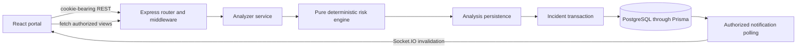
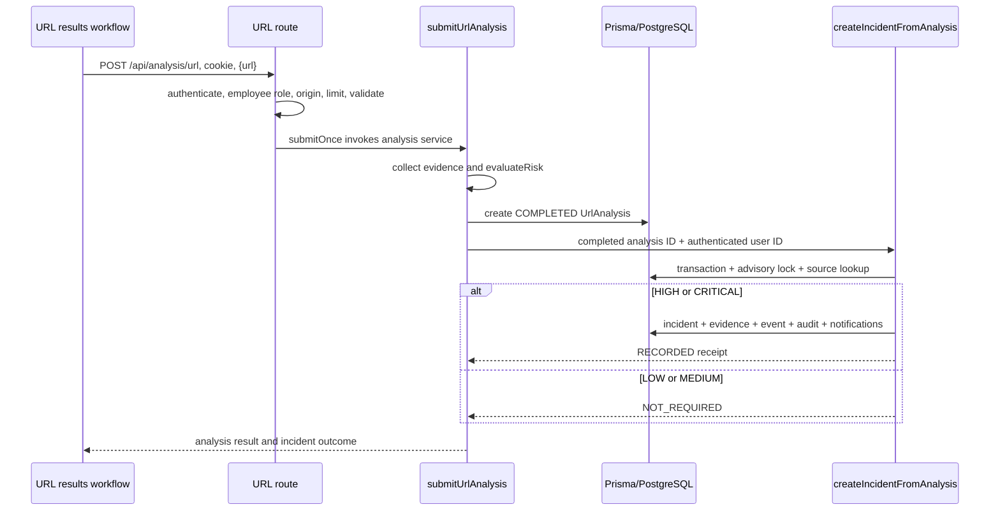
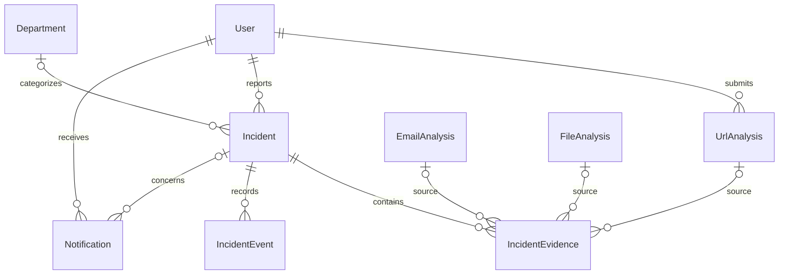
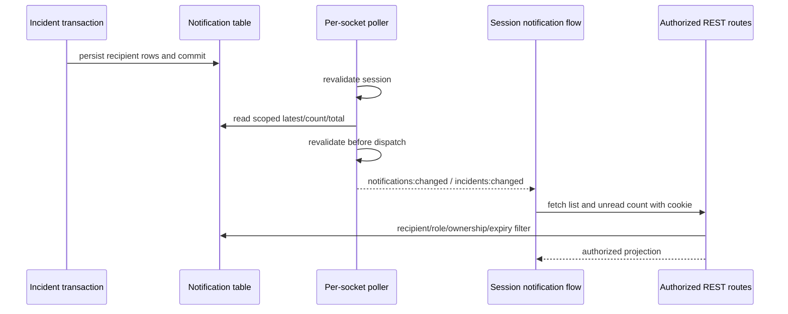

# EWAGuard AI — Technical investigation and viva reference

**Status: PARTIAL INVESTIGATION CHECKPOINT, 14 November 2026. This is not yet the definitive whole-application report.**

This first section covers repository discovery and a detailed source trace of deterministic risk evaluation, automatic escalation, explicit credential-exposure reporting and notification transport. The remaining modules and five companion deliverables are tracked in [INVESTIGATION_CHECKLIST.md](INVESTIGATION_CHECKLIST.md). The discovery inventory is [FEATURE_INVENTORY.md](FEATURE_INVENTORY.md). Do not use the existence of this requested filename as evidence that the complete request has been fulfilled.

## 1. Investigation method and evidence limitations

The evidence baseline is the current working tree, not an assumed clean commit. Numerous source, test and script files were already modified before this investigation. No application source, dependencies, configurations, schemas, migrations or tests were changed for this work. References below are repository-relative and line numbers refer to the inspected files; later edits can move those lines.

The repository inventory included frontend/backend source, shared modules, manifests, test filenames, documentation filenames, Prisma schema/model names, migration filenames, scripts and knowledge-corpus filenames. Full semantic inspection of every file is **not complete**. Specific functions named in the detailed chapters were read and traced. A directory inventory is not an exhaustive security audit.

The three requested academic source documents (`EWAGuard_AI_Project_Proposal_Final.docx`, `codex_master_prompt.docx`, `IT8x99 Thesis Assesment.docx`) did not appear in the repository filename search. Existing company-policy DOCX files are not substitutes. Consequently no claim about actual university marking criteria or achievement against those three documents is made. The supplied AGENTS.md establishes intended scope, not proof of implementation or organizational approval.

Evidence labels:

| Label | Meaning in this investigation |
|---|---|
| IMPLEMENTED | A usable execution path was traced in current source; deployment operation is not implied. |
| VERIFIED | A stated behavior was executed and its outcome observed; the exact test scope matters. |
| PARTIAL | A specific missing part of an implementation was established. |
| MOCK | Simulated or placeholder application functionality was established. Test fixtures are not automatically mocked product functionality. |
| PLANNED | A requirement exists without established implementation. |
| UNCERTAIN | Insufficient investigation or runtime evidence; does not mean absent. |

Only one test file was executed in this checkpoint: `node --test backend/tests/risk-engine.test.js`. It passed 13 tests with zero failures, skips or cancellations. There were no database migrations, live API requests, paid AI calls, external scans or server startup. Server startup was deliberately not used as a harmless check: `backend/src/server.js` starts retention workers and cleanup operations. No browser demonstration was performed.

## 2. What EWAGuard AI is

### Beginner explanation

EWAGuard AI is a prototype employee security workspace. The employee-facing interface contains an assistant, suspicious-content analysis pages, incident history, password-security tools, training, quizzes, certificates and a community. The administrator interface contains incident management, user management, analytics, audit views and awareness/community administration. Those are observed route families in `frontend/src/App.jsx`; their individual completeness is still being investigated.

The most thoroughly traced workflow is: an employee submits an item, application code collects evidence, a fixed policy computes risk, and high-risk results become security incidents for human review. Notifications help the security team discover those incidents. The employee does not need to interpret raw scanner output unaided, and the application does not need an AI model to decide the numeric risk score.

### Technical explanation

The application is a React frontend with role-separated routes and an Express backend composed of feature router factories. Prisma supplies access to PostgreSQL through the PostgreSQL adapter. The inspected analysis path separates analyzer evidence, deterministic risk evaluation and incident persistence. Authentication middleware attaches a server-resolved user; incident creation retrieves that user's completed analysis from storage rather than accepting a user-supplied severity.

Incident creation uses a transaction containing incident evidence, an event, audit metadata and recipient notifications. Socket.IO subsequently sends invalidation signals based on authorized notification queries. Clients then fetch authorized REST resources. This is an evidence-led triage design, not simply a chatbot UI wrapped around an LLM.

AI, RAG, learning and community modules are present and wired at the application level. Their complete execution paths require the later investigation sections. Do not claim that every intended tool or every proposed learning workflow is complete merely from these registrations.

### 60-second viva explanation

“EWAGuard AI is an enterprise cybersecurity prototype designed to help employees recognize suspicious activity and get appropriate guidance, while giving the security team a structured incident workflow. The key design principle is that security tools collect evidence, a deterministic risk engine evaluates it, and AI is intended to explain and coordinate rather than independently decide whether something is malicious. In the implemented analysis workflow, a completed high or critical result can create an incident with minimized evidence, an audit event and persistent notifications. The administrator receives a real-time refresh signal and can use the incident interface. The application also brings awareness features into the same employee and administrator portals. My risk scores are transparent policy scores, not probabilities of compromise. A low score does not guarantee safety, and the prototype supports human security review rather than replacing it.”

### Motivation, users and organizational boundaries

The intended problem is fragmented employee reporting and difficulty interpreting suspicious messages, links and files. The EWA-specific value proposed by the project is to connect employee guidance with security-team response and awareness in one interface. This is a **project rationale**, not evidence of measured EWA incident reduction, stakeholder interviews, production deployment or EWA endorsement.

The two inspected roles are `EMPLOYEE` and `IT_SECURITY_ADMIN`. React routes split their workspaces; backend authorization independently checks the server-resolved role. Awareness pages coexist with response pages, but the deeper relationship between incidents and training assignments remains a separate investigation item. No claim of measured learning improvement is supported by this checkpoint.

## 3. Architecture established so far

`backend/src/app.js:createApp` builds the Express application, accepts injected dependencies for feature testing, constructs shared analysis gates and threat intelligence, mounts routers, then installs not-found and error handlers. `backend/src/server.js` parses configuration, performs cleanup, starts retention workers, creates an HTTP server and attaches Socket.IO.

`frontend/src/App.jsx` wraps routes in authentication and toast providers, uses `ProtectedRoute`, and places the portals inside `AppShell`. `frontend/src/layouts/AppShell.jsx:162` mounts `NotificationProvider`. Frontend requests use `frontend/src/services/api.js:apiRequest`, which sends cookies using `credentials: 'include'`, adds JSON content type when appropriate, maps error responses into `ApiError`, and dispatches session-expiry events for relevant 401 responses.



This diagram is a **source-traced subsystem diagram**, not a claim of live integration verification or a complete AI/RAG architecture.

### Technology responsibilities and tradeoffs in this path

| Technology and manifest range | Actual responsibility/evidence | Benefit, alternative and limitation |
|---|---|---|
| React `^19.2.0`, React Router `^7.18.4` | Components and role-separated route tree in frontend manifest and `App.jsx` | Reusable interactive views; an alternative would be a server-rendered UI. Browser routing cannot enforce backend permissions. |
| Tailwind `^4.1.0`, lucide-react `^0.468.0` | Utility classes and icons in `UrlAnalyzerPage.jsx` and `ExposureReport.jsx` | Consistent styling/icons; plain CSS or another design system could serve this role. Appearance does not establish accessibility compliance. |
| Express `^5.1.0` | Router factories, middleware, JSON request parsing | Small composable HTTP layer; Fastify is an alternative. Validation and authorization remain application responsibilities. |
| Prisma client/adapter `^7.10.0`, pg `^8.16.3` | `config/database.js` constructs Prisma with `PrismaPg`; service code uses transactions and queries | Relational access and generated client; direct SQL is an alternative. Generated client and deployed schema must match. |
| PostgreSQL | Advisory transaction locks, uniqueness constraints and relational storage | Atomic updates and integrity fit incident workflows. A document store would require different consistency decisions. Database unavailability prevents authenticated operational flows. |
| Socket.IO server/client `^4.8.4` | Server `attachRealtime`, client notification flow | Connection management and websocket/polling transport. SSE or REST polling are alternatives; this implementation still polls the database per socket. |
| jsonwebtoken `^9.0.2`, cookie-parser `^1.4.7` | Signed access tokens transported in cookies | Standard token verification plus cookie parsing. This application also checks database state, so tokens do not make it stateless. |
| Helmet `^8.1.0`, cors `^2.8.5`, express-rate-limit `^8.7.0` | App headers/CORS and route throttles | Defense in depth. None replaces ownership checks or input validation. |
| Node.js crypto | URL hash, JWT identifiers and other local primitives in inspected imports | Built-in primitives avoid unnecessary dependencies; hashing is not encryption or anonymization. |
| MailParser `^3.9.36` | Local email parsing exercised by a risk test | Parses message structure; does not independently authenticate sender ownership or establish maliciousness. |

These are manifest declarations, not a verified inventory of installed versions. The manifests also declare OpenAI, otpauth, PDFKit, pdfjs-dist, sharp, yauzl, saxes, htmlparser2, ipaddr.js and zxcvbn. Their complete usage and rationale belong to later chapters; library presence does not prove a feature. No Docker/Compose configuration appeared in the initial nonignored filename search, so deployment architecture is not yet established.

## 4. Feature deep dive — deterministic risk evaluation

### 4.1 Name, purpose and user experience

The URL results page presents an “EWAGuard Risk Level” above a separate “Analysis Summary: Analyzer Finding” (`frontend/src/features/url/UrlResults.jsx`). These are different concepts. The analyzer's provisional classification summarizes local findings. The central risk engine assigns a numeric score, risk level, confidence, reasons and recommended actions using versioned policy.

The employee opens an analysis page, submits an item, and sees the returned risk with evidence and incident guidance. Risk is not a separate form where the employee chooses a severity. In the traced URL flow, `UrlAnalyzerPage` submits through `createUrlFlow`; `analyzeUrl` posts `{url}` to `/api/analysis/url`; the route invokes `submitUrlAnalysis`; persistence evaluates risk; the response renders `RiskResult`, `IncidentReceipt`, `ExposureReport` and `IncidentAssistance`.

### 4.2 Internal execution and libraries

`backend/src/risk/risk-engine.js:6` exports `evaluateRisk`. Its inputs are `analyzerType`, structured `evidence`, optional `evaluatedAt` and narrowly defined trusted `confirmedContext`. It imports only local risk modules. It has no network, model, filesystem or database dependency. The caller supplies time so freshness calculations can be repeatable.

`normalizeRiskEvidence` (`evidence-adapters.js:246`) accepts only EMAIL, URL and FILE. It checks consumed structures, provider counts/statuses and boolean fields, and maps known indicator IDs to fixed policy rules. Unknown indicator IDs produce a coverage limitation rather than arbitrary scoring. Extra client score fields and provisional classifications do not control the result.

The algorithm is:

1. Validate the timestamp and confirmed-context shape.
2. Normalize evidence into signals, available/unavailable sources, notes and conflict information.
3. Deduplicate by **reason code**, keeping the largest weight. Different IDs mapped to the same reason therefore do not stack.
4. Sort by descending weight, then reason-code order for reproducibility.
5. Limit contributions within each category's cap.
6. For email, add an 8-point combination signal when a credential/MFA request occurs alongside another category.
7. Determine whether CRITICAL is eligible from strong-source corroboration or a separately confirmed credential submission.
8. Sum contributions. Confirmed credential submission can raise the raw score to at least 75.
9. Cap the final score at 100 if critical-eligible, otherwise 74.
10. Calculate confidence separately, attach fixed descriptions and coverage notes, and choose recommended actions by severity.

Key excerpt (`risk-engine.js`, within `evaluateRisk`):

```js
const score = Math.min(rawScore, criticalEligible ? P.maximum : P.thresholds.CRITICAL - 1);
```

This means the threshold helper alone does not describe the complete classification algorithm.

### 4.3 Exact thresholds, caps and critical gate

Risk policy version is **1.1** (`risk-policy.js:2`). LOW is 0–24, MEDIUM 25–49, HIGH 50–74, CRITICAL 75–100. `riskLevelForScore` rejects nonintegers and out-of-range values.

Category caps are: identity 25, content 35, authentication 15, attachment 25, emailUrl 25, financial 20, process 15, structure 40 and TLS 8. Categories without an explicit cap use the maximum 100. Limits are 128 indicators, four URL reputation reports, 64 YARA matches and 10,000 per provider count field.

CRITICAL is eligible if any of these holds:

- The trusted context explicitly confirms corporate credentials submitted to a phishing site.
- At least two distinct strong sources exist.
- At least one strong source exists **and at least two positive structural signals** together contribute at least 25.

The policy field `structuralGroups` is named like a group count, but the implementation actually checks `structural.length`: distinct surviving structural signals, not two different categories. Email local heuristics do not create a strong source, so arbitrary accumulation of email heuristics stays below CRITICAL without separate confirmation.

### 4.4 All scoring factors

See [RISK_POLICY_TABLES.md](RISK_POLICY_TABLES.md) for every EMAIL, URL and FILE indicator-to-reason mapping and weight extracted from the inspected policy. These are final-engine policy weights; the smaller `severityWeight` values in `email-analyzer.js:RULES` belong to provisional analyzer classification and must not be substituted.

Additional weights are ClamAV detection 60; strong YARA match 50; warning YARA match 25; demo-only YARA match 0; TLS certificate concern 8; email credential/MFA corroboration 8. Multiple YARA matches do not multiply the score: the adapter uses the strongest applicable level.

VirusTotal contribution is selected from the reported counts:

| Condition | Contribution |
|---|---:|
| At least 5 malicious, at least 10 total, and malicious/total at least 0.10 | 60 |
| Otherwise at least 2 malicious | 30 |
| Otherwise at least 1 malicious | 12 |
| Otherwise at least 1 suspicious | 8 |
| Otherwise | 0 |

The total is malicious + suspicious + harmless + undetected. Overlapping URL/domain reports from VirusTotal are treated as one correlated provider; only the strongest selected reputation contribution is used. Harmless votes do not subtract from positive evidence. They do affect the denominator used for consensus. A consensus report counts as a **strong source** only if freshness is established within 30 days, including the exact boundary. Stale, absent or future dates do not erase detections, but prevent that report from serving as fresh strong corroboration.

### 4.5 Missing evidence, conflict and confidence

Missing checks do not contribute an invented malicious score. They reduce coverage and can produce `INSUFFICIENT_EVIDENCE`, `PROVIDER_UNAVAILABLE` or other fixed notes. Therefore score zero with limited confidence is possible and does not mean safe.

Email SPF/DKIM/DMARC data are supplied header claims. Their availability is tracked, but `EMAIL_UNVERIFIED_HEADERS` is always added. Attached files and extracted links in an email are explicitly treated as lacking attachment scans/link reputation within this email evidence path.

Email confidence can reach MODERATE when local evidence is present and no unavailable/limited condition is recorded. It does not become HIGH here. URL/file confidence first requires a usable detection-capable source; HIGH additionally needs the configured source-count condition and no missing or limited coverage. For files the high-confidence count uses detection-capable sources; URL high-confidence counting uses available sources. “Detection-capable” does not mean the source returned a positive detection.

Conflicting results retain positive scores and reduce confidence: HIGH becomes MODERATE; otherwise confidence becomes LIMITED. A clean ClamAV response alongside a positive reputation result therefore does not neutralize the reputation signal.

### 4.6 Worked examples using the actual algorithm

These are **illustrative synthetic evidence calculations**, not claims about a scanned real email, website or file. Related behavior was exercised by the risk-engine tests.

**Example A — urgency alone:** EMAIL `URGENCY` contributes 4 in content. No credential/MFA combination applies. Final score 4 → LOW. Missing authentication claims change coverage/confidence, not that 4-point contribution.

**Example B — credentials and Reply-To mismatch:** EMAIL `CREDENTIAL_REQUEST` contributes 25 content; `REPLY_DOMAIN_MISMATCH` contributes 18 identity. Two categories with a credential request add 8. Total = 25 + 18 + 8 = **51, HIGH**. A completed stored result meets the incident policy. Adding duplicate urgency or mismatch entries cannot manufacture repeated independent evidence.

**Example C — suspicious URL with corroboration:** Assume fresh VirusTotal counts 15 malicious and 45 undetected (15/60 = 25%), plus `IDN`, `ACCOUNT_PATH`, `BRAND_PATTERN`. Reputation = 60. Structural signals sort as 18 + 15 + 10, but the structure cap makes contributions 18 + 15 + 7 = 40. Fresh consensus is one strong source; at least two positive structural signals contribute at least 25. CRITICAL is eligible. Total 100 → **CRITICAL**. If the report is stale, its 60 points remain, but the strong-source gate fails and the final score is capped at **74, HIGH**.

**Example D — two static scanner sources:** ClamAV DETECTED = 60; YARA STRONG = 50. The shared scanner category defaults to a 100 cap, so contributions are 60 + 40. Two strong sources qualify for CRITICAL; final score **100**. An unavailable reputation provider still limits coverage. A pure DEMO YARA match contributes zero.

**Example E — separately confirmed exposure:** A stored EMAIL risk of 20 becomes `max(20, 75) = 75`, CRITICAL, when the employee explicitly confirms credential exposure through the separate route. A stored score of 92 remains 92. This is a precautionary escalation based on user-reported interaction, not proof that the site was malicious.

### 4.7 Database interaction and output contract

The pure engine does not write to a database. `riskColumns` (`risk-persistence.js:3`) maps `score`, `riskLevel`, `version` to `riskScore`, `severity`, `riskRuleVersion`. `riskSnapshot` provides a minimized projection with reason codes, confidence, timestamp and coverage.

The actual output uses `score` and `riskLevel`; do not present the illustrative AGENTS.md `riskScore`/`severity` object as the exact API result. Output also includes reasons with contributions, `scoring.uncappedScore`, `scoring.capped`, `scoring.criticalEligible`, `evidenceCoverage` and recommended actions. The **sum of displayed contributions can exceed the final score** when the final 74/100 cap applies.

`persistUrlAnalysis` (`url-analyzer.js:64`) computes risk, creates a completed UrlAnalysis record with evidence, expiry, hostname and a hash of the redacted URL, then returns result and assistance. The email equivalent is `email-submission.js:persistEmailAnalysis`, which minimizes stored evidence. Incident projection checks agreement between JSON risk and typed analysis columns before escalation.

### 4.8 Security, errors and limitations

Malformed consumed evidence raises `TypeError`; it does not quietly become a benign result. Fixed reason descriptions prevent provider-controlled strings from becoming risk explanations. Confirmed context accepts one known boolean key and must come from a trusted caller, not analyzed text or model arguments.

The weights express policy, not a calibrated probability. Tests demonstrate reproducibility and boundary handling, not real-world detection accuracy. False positives are possible for legitimate urgency, login requests, internationalized domains and unusual file names. False negatives are possible for novel threats, absent reputation, unsupported content or missing evidence. No measured precision, recall or false-positive rate was established in this checkpoint.

### 4.9 Viva explanation and questions

“My risk engine is deterministic and versioned. It maps validated evidence to fixed reasons, avoids duplicate counting, caps correlated categories and requires corroboration before critical severity. Confidence records evidence coverage separately. The result can be reproduced from the same evidence and time, but it is a triage policy score, not a probability that an item is malicious.”

1. **Why not ask the AI for severity?** The inspected scoring path contains no AI call. Fixed policy is auditable, testable and independent of model phrasing.
2. **Can many suspicious email phrases make an incident critical?** Not alone. The final score is capped at 74 without critical eligibility; separately confirmed credential exposure is a different trusted workflow.
3. **Does unavailable VirusTotal mean low risk?** It contributes no fabricated detection and adds coverage limitations. Other evidence may still yield high risk; low score with missing evidence is not a safety verdict.
4. **Why do two VirusTotal reports not count as two strong sources?** URL and domain reports share a provider and can overlap; the adapter counts a single correlated source.
5. **How can a score be trusted?** Its derivation is transparent and tested. That establishes internal consistency; empirical calibration still requires labeled evaluation data.

Implementation evidence: `risk/risk-policy.js:9`, `risk/risk-engine.js:6`, `risk/evidence-adapters.js:65`, `:142`, `:174`, `:203`, `risk/risk-persistence.js:3`, `ai/tools/tool-results.js:50`, `backend/tests/risk-engine.test.js`.

## 5. Feature deep dive — automatic incident recording and recovery

### Purpose and employee experience

High/critical completed analyses become recorded security work rather than only a transient result card. The user sees `RECORDED`, `NOT_REQUIRED` or `PENDING`. `IncidentReceipt.jsx` renders the human reference, severity/status and urgent-review language. If escalation failed after analysis completed, the user can select **Retry incident recording**, which submits an empty JSON object to the recovery endpoint rather than rerunning the scan.

### Complete traced path



On transaction failure, `completeAnalysisEscalation` catches the failure and returns PENDING/retryable with a recovery path. The URL route returns HTTP 202 for that pending outcome, otherwise 201. This means analysis persistence and incident persistence are **not one transaction**; incident-related writes themselves are transactional. The distinction explains why recovery is needed.

### Deterministic decision and stored evidence

`escalation-policy.js` version 1.0 permits HIGH and CRITICAL, marks CRITICAL urgent, starts at NEW and always requires human review. Its 90-day review date is explicitly a development review deadline, not an approved EWA deletion schedule.

`createIncidentFromAnalysis` (`incident-engine.js:150`) validates type and UUIDs, normalizes UUID case, computes `sourceKey = analyzerType + ':' + analysisId`, and takes a PostgreSQL transaction advisory lock using that key. A unique database index provides the final deduplication boundary. If the incident already exists, ownership is checked before returning its receipt. Otherwise a completed analysis belonging to that user is loaded. `projectToolResult` validates and minimizes its stored risk.

The creation service (`recordIncident`, line 58) reads the reporter's current department and saves it on the incident; constructs a fixed title/description; copies risk score/version/level; determines type from allow-listed reason codes; creates minimized evidence; writes a CREATED event; writes an audit event; and creates notifications in the same transaction. There is no OpenAI call in this path. Fields such as `aiSummary` and `mitreTechniqueIds` exist in the model but are **not populated by this automatic creation function**. Do not claim automatic AI summaries or automatic ATT&CK mapping based only on their presence.

Type priority is credential compromise, then malware, then phishing, otherwise suspicious activity. Some mapped reasons are heuristic (including suspicious reputation), so an incident type is a review category, not proof of confirmed malware or phishing.

### Data model and constraints for this subsystem

| Model / source line in `backend/prisma/schema.prisma` | Purpose and lifecycle |
|---|---|
| EmailAnalysis :439 | UUID key, owner, required acknowledgement, status, minimized evidence, score/severity/version and expiry. Created by completed email persistence. |
| UrlAnalysis :467 | UUID key, owner, optional acknowledgement, hostname, redacted-URL hash, evidence/risk/expiry. Created before escalation. |
| FileAnalysis :495 | UUID key, owner, upload/hash kind, SHA-256, optional size/type/storage data, scanner statuses and risk. Full file lifecycle not yet investigated. |
| Incident :531 | UUID key; unique auto-incrementing number; unique nullable sourceKey; reporter, optional assignee/department; risk and status; operational timestamps and retention/legal-hold fields. |
| IncidentEvidence :579 | UUID key, required incident, minimized JSON snapshot, optional source-analysis links. Analysis links use SetNull on deletion so the snapshot can survive permitted source removal. |
| IncidentEvent :602 | UUID key, incident, optional actor, type and allow-listed metadata; records creation and later exposure changes. |
| IncidentComment :619 | UUID key, incident/author and visibility with SECURITY_TEAM default. Actual management authorization remains to be traced. |
| Notification :637 | UUID key, recipient, audience, incident, kind, severity, read/expiry dates. `(recipientId,eventKey)` unique constraint deduplicates event notifications. |
| RevokedSession :666 | Token identifier and expiry, not the JWT itself. Checked by session authentication. |

The incident's reporter/assignee/department relationships use restrictive deletion. `sourceKey` and notification uniqueness are also explicitly introduced by migrations `20261009000300_automatic_incidents/migration.sql` and `20261010000200_incident_notifications/migration.sql`. These SQL files were read, not applied or checked against a running database.



This is a partial ERD of inspected relations, not the requested whole-database ERD.

### Security and errors

The retry endpoint requires employee authentication, trusted-origin validation, a per-user 30/minute limiter and bounded 1 KB JSON parsing. It rejects supplied incident fields. The service takes `userId` from the authenticated request and queries the source with that owner. Inaccessible/missing source returns 404; incomplete or incompatible stored risk returns 409; unexpected transactional failure becomes 503 `ESCALATION_PENDING`. No client-supplied title, severity or evidence is accepted by the recovery API.

Advisory locking serializes competing operations for a source across processes; uniqueness prevents duplicate incident insertion at the database level. A stored analysis remains recoverable after its expiry timestamp while still stored: expiry alone does not discard outstanding escalation. Actual retention-worker behavior remains to be audited.

### Demonstration and viva

Illustrative demonstration: after an authorized synthetic email analysis produces the 51-point result from Example B, expect a HIGH incident receipt if storage succeeds. If it shows PENDING, explain that analysis completed but escalation failed; use the retry action. Do not claim that an administrator has viewed the alert merely because a receipt says recorded.

“I create incidents from finalized stored evidence, not from the employee's requested severity. The incident transaction includes its evidence, timeline event, audit record and notifications. Repeated submissions use the source identity to prevent duplicates, and recovery can retry recording without repeating the security scan.”

1. **Can an employee set severity to CRITICAL in a retry request?** No; extra fields are rejected, and the server reloads finalized risk from that employee's analysis.
2. **What happens if notifications fail to save?** They are inside the incident transaction, so that transaction fails; the completed analysis can still be available for retry.
3. **Does RECORDED mean someone investigated it?** No. It starts NEW and requires human review. Persistence is different from delivery, reading or resolution.

Limitations: database operation was not executed; high-risk classification may be a false positive; a failed transaction can delay escalation; persistent notification creation depends on eligible administrator accounts. No production response-time guarantee was established.

Evidence: `routes/url-analysis.js:13`, `analyzers/url/url-analyzer.js:55`, `incidents/incident-engine.js:43`, `:58`, `:150`, `:403`, `incidents/escalation-policy.js`, `routes/analysis-escalations.js:20`, `frontend/src/components/IncidentReceipt.jsx`.

## 6. Feature deep dive — “I entered my credentials”

### Purpose and interaction

The `ExposureReport` component asks whether the employee entered work credentials or a verification code after opening the analyzed email/link. The user clicks **I entered my credentials**, then **Yes, report exposure** in a confirmation modal. The UI never requests the actual password/code. It is mounted in email and URL results; source search also found its use in chat evidence.

### Internal and database behavior

The client sends exactly `{exposure: 'CREDENTIALS_SUBMITTED', confirmed: true}` to `/api/analysis-escalations/:analyzerType/:analysisId/exposure`. The route rejects missing confirmation, wrong values and additional fields. Only EMAIL/URL sources are supported by the service.

`reportCredentialExposure` (`incident-engine.js:178`) uses the same source lock and ownership boundary. If no incident exists, it loads the completed analysis, raises its risk snapshot using `escalateConfirmedRisk`, generates assistance and creates a critical incident. If an incident exists, it locks that incident row `FOR UPDATE`, validates the evidence snapshot against incident risk columns, and updates incident evidence/risk/type and audit/event records atomically.

The original analysis's risk columns are not rewritten in this service. Instead the incident's evidence preserves `originalRisk`, the escalated risk, and the exposure report. This explains why an original analysis result can differ from the incident's later severity.

RESOLVED, FALSE_POSITIVE and CLOSED incidents reopen to UNDER_INVESTIGATION, with resolved/closed timestamps cleared. Already-open incidents retain their status. Repeated confirmation returns the existing exposure outcome without duplicate changes. The service emits an EVIDENCE_ADDED or SEVERITY_CHANGED event, plus STATUS_CHANGED when reopening, and persists EXPOSURE_REPORTED notifications.

### Security, errors and limitations

The caller's identity is server-derived, the source must belong to them, and the input cannot supply a new score. The rule is deterministic and monotonic: `max(storedScore, 75)`. It does not establish that credentials really were captured; the employee's report triggers precautionary human review. The UI asks about verification codes/usernames too, while the stored event is the coarser CREDENTIALS_SUBMITTED category. Do not claim a forensic distinction between those exposures.

The same bounded parsing and rate limiting as recovery apply. The UI handles missing/incompatible source or failure by directing the user to their approved security reporting channel. It shows returned reference/status/severity and assistance after success. The implementation does not change passwords or remediate endpoints automatically.

Illustrative demo: use a synthetic owned EMAIL analysis and confirm a **simulated** exposure in a designated demonstration environment. Expect an incident score at least 75; do not enter a real password. This is a database-writing demo suggestion, not an action performed during this investigation.

### Viva explanation and questions

“The analyzed email cannot itself instruct the application to say I entered credentials. That information comes from a separate authenticated confirmation. It raises incident urgency deterministically, preserves the earlier evidence and can reopen an incident because the exposure is new information.”

1. **Can an LLM set this flag by interpreting chat?** The inspected exposure route accepts a fixed explicit confirmation and uses the authenticated user. The complete AI tool registry still requires separate review; do not generalize beyond the traced boundary.
2. **Does the feature store the exposed password?** No password field exists in this route/component; it stores a category, source and timestamp.
3. **Does a second confirmation duplicate the incident?** The source lock, unique key and already-reported check make repeated reports idempotent in the inspected service.

Evidence: `frontend/src/components/ExposureReport.jsx:16`, `frontend/src/features/url/UrlResults.jsx:44`, `frontend/src/features/email/EmailResults.jsx:59`, `backend/src/routes/analysis-escalations.js:40`, `backend/src/risk/risk-engine.js:99`, `backend/src/incidents/incident-engine.js:178`, `backend/src/incidents/escalation-policy.js:EXPOSURE_REPORT_POLICY`.

## 7. Feature deep dive — persistent notifications and real-time refresh

### Purpose and interaction

The notification system gives users authorized updates and refreshes incident views. It separates durable records from transient transport: a socket disconnect must not erase an incident or its notification. `AppShell` mounts a session-scoped `NotificationProvider`; the flow manages list, unread count, pagination, mark-read, reconnection and incident listeners.

### Persistence and recipient selection

`persistIncidentNotifications` (`notification-service.js:19`) runs inside the incident transaction. It creates fixed messages with event keys and expiry. Eligible administrator recipients are ACTIVE, not deactivated, have the admin role and have MFA enabled. They are queried in batches of 200, including offline users. Certain status/employee-update events also create an employee recipient row; private investigation updates do not automatically become employee alerts.

`notificationScope` (line 73) always filters recipient ID, current audience, permitted kind, expiry and incident relation. Employees are restricted to STATUS_CHANGED/EMPLOYEE_UPDATE and incidents they reported. Mark-read first finds a row inside this scope, updates only unread matches and records a NOTIFICATION_READ audit entry when state changed.

### Transport implementation

`attachRealtime` (`realtime.js:8`) attaches Socket.IO at `/api/realtime`, using the same HTTP server. It allows trusted origins, limits handshake attempts, limits sockets per user, parses the HttpOnly cookie, and calls `authenticateSession`. Handshake auth objects and unexpected query credentials are rejected. Each connection joins `user:<id>`; administrators also join `verified-administrators`. The inspected implementation emits directly to individual sockets; room membership is not evidence of an unrestricted room broadcast.

Every default **5 seconds**, each connected socket rechecks the session and queries latest notification ID, unread count and total within the user's scope. It rechecks authentication after reads before emitting. Expiry, revocation/role changes and failures disconnect. There is no client-controlled room-join API; incoming application events trigger disconnection.

| Server event | Payload and meaning | Client reaction |
|---|---|---|
| `notifications:ready` | `{recovery: 'FETCH_AUTHORIZED_LIST'}` on initial observed state | Mark connection live, refresh authorized notifications and notify incident subscribers. |
| `notifications:changed` | No incident evidence payload | Debounced notification REST refresh. |
| `incidents:changed` | No incident evidence payload | Debounced incident-view refresh callbacks. |

Unread changes affect notification refresh; they do not themselves trigger incident refresh. Creation/removal changes in latest/total can trigger incident invalidation. This is near-real-time polling plus push, not an instantaneous database change feed.



### Client behavior and failure recovery

`notification-flow.js` creates one memory-only store/socket per mounted session. It supports websocket and polling transports, disables library automatic reconnection, and implements up to five retries with exponential delays capped at 16 seconds. Session identity is rechecked through `/api/auth/me` when connection is lost. A server disconnect hides cached notifications until checked. Generation counters and AbortControllers prevent stale requests updating a later session. REST 401/403 stops the flow and signals session/access change.

`NotificationProvider.jsx` refreshes on return to a visible page and stops on signout/session expiry. `IncidentPages.jsx` and `AdminDashboardPage.jsx` subscribe to incident changes. A disconnected client can still recover persisted rows using REST; socket messages themselves are not a durable queue.

### Security and limitations

The socket uses server-side identity, not a role supplied by the browser. Session authentication checks JWT issuer/audience/algorithm, revocation and current user/session version. `findActiveUser` checks status/deactivation/deletion and requires an MFA proof matching the stored administrator MFA enrollment timestamp. This is evidence for session checks, not a completed audit of MFA enrollment or recovery.

An incident receipt's wording that the team is alerted is not proof that a human saw it. The recipient query could find no eligible administrators, and socket connectivity/delivery is separate. The `Notification.deliveredAt` model field is not updated by the inspected poller. A demonstration must verify the administrator notification list itself.

Per-socket database polling and repeated authentication queries create a scaling cost. Multi-instance load, production latency and failure recovery were not measured. Server code limits total connected clients to 1,000 and five sessions/sockets per user in the local process; this is not a demonstrated enterprise capacity benchmark.

### Viva explanation and questions

“Notifications are saved with the incident so they survive disconnection. The socket only says that authorized data may have changed. The browser then fetches its permitted view over REST. That limits sensitive information in real-time messages and provides recovery when the connection drops.”

1. **Why REST and sockets?** REST retrieves the authorized data; socket invalidations make the UI refresh without the user manually checking constantly.
2. **What if a socket fails during incident creation?** The creation transaction has no socket I/O. Notifications remain stored and can be fetched later.
3. **Is the alert immediate?** The server's default poll interval is five seconds, plus request and rendering time. No hard delivery SLA was verified.
4. **Could an employee join the administrator room?** The inspected code assigns rooms from authenticated server identity and disconnects on incoming application events; there is no client join handler.

Evidence: `backend/src/notifications/realtime.js:8`, `notification-service.js:19`, `:73`, `:105`, `routes/notifications.js:9`, `auth/session.js:7`, `auth/auth-token.js`, `frontend/src/features/notifications/notification-flow.js`, `NotificationProvider.jsx`, `notification-api.js`, `frontend/src/layouts/AppShell.jsx:162`.

## 8. API reference — completed subsystem only

This table is not the complete API inventory. It documents endpoints traced in this checkpoint. All require the session cookie; roles and request details are below. Middleware errors use an `{error: {code, message}}` envelope for the inspected custom handlers.

| Method and actual path | Role; important input | Response and implementation/database work |
|---|---|---|
| POST `/api/analysis/url` | EMPLOYEE; JSON with only `url`; optional Idempotency-Key header; 26 KB body limit; rate/concurrency gate | 201 completed analysis/incident outcome, or 202 if escalation pending. `submitOnce` calls `submitUrlAnalysis`; completed UrlAnalysis insert, then potential incident transaction. Full submitOnce semantics remain to be reviewed. |
| POST `/api/analysis-escalations/:analyzerType/:analysisId/retry` | EMPLOYEE; own completed source; empty JSON; 1 KB; 30/minute | `{analysisId, incident}`; retrieve or create incident from stored evidence. No caller-selected severity. |
| POST `/api/analysis-escalations/:analyzerType/:analysisId/exposure` | EMPLOYEE; EMAIL/URL; exact exposure enum and confirmed true; 1 KB; shared limiter | `{analysisId, incident}`; create or upgrade/reopen incident, evidence/events/audit/notifications transaction. |
| GET `/api/notifications` | EMPLOYEE or IT_SECURITY_ADMIN; `limit` default 20, 1–100; optional base64url cursor `before`; `unread=true/false` | `{items, nextCursor}` from scoped notifications, descending createdAt/ID. Extra query fields rejected. |
| GET `/api/notifications/unread-count` | Both roles; no query fields | `{unreadCount}` for authorized unexpired unread rows. |
| POST `/api/notifications/:id/read` | Both roles; empty JSON, no query fields; 1 KB | `{notification}`; ownership-scoped transactional update, audit only if changed. |

Notification routes share a 120/minute per-user limiter. These write routes use POST rather than REST PATCH; HTTP verbs describe operation conventions, not security guarantees. PUT/DELETE routes were discovered in community, but their contracts are outside this checkpoint. No PATCH contract should be invented for incident updates without inspecting the actual routes.

### Request security established in this path

The app installs Helmet, CORS and cookie-parser before feature routes. CORS currently advertises GET, POST, HEAD and OPTIONS in `app.js`, whereas community PUT/DELETE declarations were discovered. Whether this affects a deployment depends on origin/proxy arrangement and requires follow-up; it is not a verified browser failure.

`createTrustedOrigin` checks Origin and Fetch Metadata. Same-origin browser reads may omit Origin; browser writes with Fetch Metadata must meet the origin rule. Non-browser clients may omit both headers, which is compatible with REST clients and still requires authentication. Cookie options include HttpOnly and SameSite=Lax, with Secure and a `__Host-` name in production. These measures are relevant to CSRF; they do not establish that every route is protected without tracing it.

## 9. Validation, limitations and study priorities

Actual command: `node --test backend/tests/risk-engine.test.js`, exit 0, **13 passed / 0 failed / 0 skipped**, 14 November 2026. The tests use Node's built-in test runner and strict assertions. They exercise local synthetic evidence, one local email parse, threshold boundaries, duplicates, malformed inputs, reputation correlation/freshness, conflict, demo-only YARA, privacy projections, purity and confirmed exposure. They do **not** invoke a real VirusTotal report, real ClamAV/YARA execution, PostgreSQL transaction, Socket.IO session or browser.

Functional testing checks that defined inputs produce expected behavior. Security testing challenges permission and trust boundaries. Integration testing checks components together; a filename alone does not prove real infrastructure was involved. Usability testing needs actual participant/task evidence. AI evaluation needs defined prompts, expected grounding/tool behavior and repeatable metrics. This checkpoint establishes only the stated local test results, not all those evaluation categories.

No database schema validation/formatting or migrations were run: this is documentation work, and formatting would alter a protected application file. No installed dependency audit, browser build or production scan is claimed. Existing integration tests and phase documentation are discovery evidence only until inspected and safely executed.

Study these points particularly carefully:

1. Final risk weights versus analyzer provisional weights.
2. Severity versus confidence versus actual maliciousness.
3. The corroboration gate and why email heuristics alone stop at HIGH.
4. Source-based incident idempotency and the analysis/incident transaction boundary.
5. Employee-confirmed exposure versus information contained in untrusted submissions.
6. Durable notification records versus delivery, reading and investigation.
7. Socket invalidation plus scoped REST, with five-second server polling.
8. Database model fields are not proof of operational AI summaries or ATT&CK mapping.
9. A passing synthetic test suite does not establish real-world accuracy.
10. Intended university/organizational requirements must be distinguished from available evidence.

## 10. Remaining report work

The next investigation should finish analyzer internals and assistance/incident management, then authentication/MFA/users, AI/tools, RAG, training/quizzes/certificates, community, analytics/privacy/audit, full database/migrations and full API/deployment coverage. Academic traceability is limited until the named reference documents are available. The 100-question bank, study guide, demonstration guide, quick revision and requirements matrix have **not yet been produced**; creating generic versions now would conceal missing source investigation. Resume from the checklist rather than treating this checkpoint as completion.
